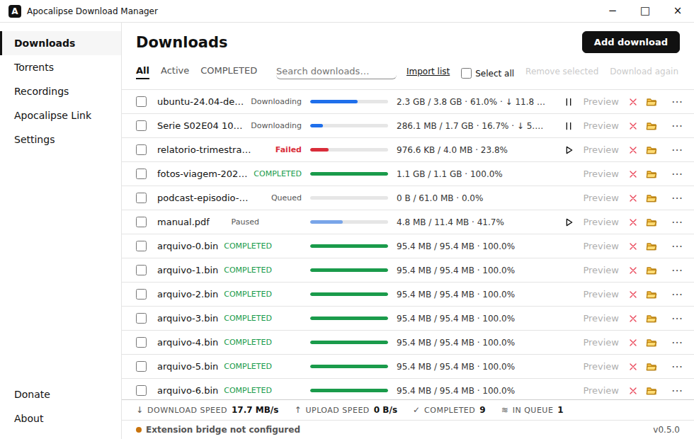

# Apocalipse Download Manager

[Português](README.md) · [English](README.en.md) · [简体中文](README.zh-CN.md)

适用于 Windows、Linux 和 macOS x64 的自由开源便携下载管理器。

[**下载**](https://github.com/linuxhell/apocalipse-download-manager/releases/latest)

| 平台 | 软件包 |
| --- | --- |
| Windows x64 | [Portable ZIP](https://github.com/linuxhell/apocalipse-download-manager/releases/latest/download/apocalipse-download-manager-windows-x64-portable.zip) |
| Linux x64 | [Portable tar.gz](https://github.com/linuxhell/apocalipse-download-manager/releases/latest/download/apocalipse-download-manager-linux-x64-portable.tar.gz) · [AppImage](https://github.com/linuxhell/apocalipse-download-manager/releases/latest/download/apocalipse-download-manager-linux-x64.AppImage) |
| macOS x64 | [Portable ZIP](https://github.com/linuxhell/apocalipse-download-manager/releases/latest/download/apocalipse-download-manager-macos-x64-portable.zip) |
| Chrome | [0.3.210 ZIP](https://github.com/linuxhell/apocalipse-download-manager/releases/latest/download/apocalipse-chrome-0.3.210.zip) |
| Edge | [0.3.210 ZIP](https://github.com/linuxhell/apocalipse-download-manager/releases/latest/download/apocalipse-edge-0.3.210.zip) |
| Firefox | [0.3.210 XPI](https://github.com/linuxhell/apocalipse-download-manager/releases/latest/download/apocalipse-firefox-0.3.210.xpi) |

新增下载窗口直接显示线程滑块，其值优先于引擎默认设置。下方复选框立即保存网站偏好；更改滑块会更新保存值，取消勾选会删除该偏好，同时保留网站凭据和其他设置。

## 快速开始

1. 下载并解压便携包，然后启动程序。便携包包含 Nibiru Xtreme，其源代码版本与 ADM 使用的固定版本一致。
2. 安装对应的浏览器扩展。Chrome/Edge：解压 ZIP，在开发者模式中选择**加载已解压的扩展程序**。Firefox：打开 Mozilla 签名的 XPI。
3. 打开**工具**，安装或更新 yt-dlp、FFmpeg 等所需引擎。AppImage 不包含 Xtreme 可执行文件，请在此安装。在 Linux 上，先为 AppImage 添加执行权限。

## 功能

- 支持断点续传的 HTTP/HTTPS、多连接、镜像与 SHA-256 校验。
- 原生种子、磁力链接及 ED2K/Kad，支持文件选择和视频预览。
- 浏览器媒体捕获、yt-dlp、HLS、FFmpeg 和渐进式录制。
- Apocalipse Link：计算机之间经过身份验证的 TLS 文件传输。
- 网站凭据保存在系统安全凭据库中；界面支持葡萄牙语、英语和简体中文。

## 0.8.18 版本

AppImage 包含固定版本的 Xtreme 后端，可变数据保存在只读挂载之外。安装后端时保留已有版本。

包含 Nibiru Xtreme 0.2.8：复用首次 GET，遵守 429/503 与 Retry-After，临时学习各来源的连接上限，并在恢复中断范围时保留已完成的数据块。复用缓冲区，并在 Windows 上准备稀疏文件。滑块设置优先于按大小计算的默认值，同时遵守所选上限。详见[集成与限制](docs/MDM-HTTP-INTEGRATION-2026-11-10.md)。继续包含 Mozilla 签名的 Firefox 0.3.210。

Chrome/Edge 0.3.210 修复通过 POST 表单生成的文件下载，例如 UUP Dump ZIP 压缩包：将已收到的响应流式传入 ADM，并保留保存位置选择，不再丢弃文件或重复请求网站。发送前若 ADM 不可用，浏览器可继续处理；POST 发送后的失败不会自动重发表单。经过 HTTP 压缩的响应按解码后的实际字节数计算。

包含 **Mozilla 签名的 Firefox 0.3.210 XPI**，与 Chrome/Edge 一样提供 POST 下载修复。

### 保留的修复

保留 Xtreme 0.2.6 修复：入站 ED2K 握手应答公布实际监听的 TCP 端口，不再填零。UPnP 发现尝试本机 IPv4 地址，并在统一截止时间内重试丢失的 SSDP 请求。顶部状态区分 TCP 接入连接与已完成的 ED2K 握手，登录日志也记录这些计数。保留 0.8.13 的 UPnP/登录顺序修复。TCP 端口测试或映射成功本身不保证高 ID，仍需服务器确认协议结果。

修复 UPnP 与 ED2K 登录的先后顺序：此前发现失败时，不再让登录与后台端口转发并行竞争。如果低 ID 登录后才确认 TCP 端口已转发，仅重新登录一次，让服务器再次测试端口。保留服务器实际返回的 ID、取消操作及服务器故障切换；UPnP 转发成功本身并不保证高 ID。

Chrome/Edge 0.3.210 优先选择已有媒体数据的播放器，结合主视频面积、播放和音频状态判断，而不只依据屏幕位置，避免选择空播放器或重叠预览。录制沿用当前播放位置，不回到开头；视频已经播放时，不再等待另一次 `play()`。即使页面 CSS 覆盖显示样式，隐藏按钮也保持隐藏。

包含用户提供的 Mozilla 签名 Firefox 0.3.210 XPI，已检查加密签名、内部哈希及源码一致性。Chrome、Edge 和 Firefox 均包含 0.3.209 的播放器和录制修改。

Xtreme 0.2.6 保留 0.2.5 对种子端口自动选择的修复：先保留 UDP/uTP，再在同一端口绑定 TCP，并释放失败尝试。修复 Windows CI 中观察到的 10013 启动错误，保留 uTP 和指定端口。如果另行配置了引擎，请在设置 → 工具中更新。

保留 Xtreme 0.2.4 引入的 HTTP/HTTPS 启动优化：单线程直接发送 GET，小文件跳过不会使用的 Range 测试。保留续传验证和滑块设置的连接数上限。[本地比较](https://github.com/linuxhell/nibiru-xtreme/blob/main/benchmarks/http-startup-2026-11-06.md)测量的是启动时间，不能证明互联网持续传输速度提高。

修复 Vimeo 捕获单独的视频 HLS 播放列表而生成无声 MP4 的问题。捕获中包含具体视频页面时，ADM 通过 Vimeo 播放器解析完整内容，并用 yt-dlp 选择及合并视频和音频。保留非公开视频的标识；缺少页面上下文的直接链接保持原样。

精简添加下载窗口：高度随内容调整，左侧显示高级选项，右侧显示九个最近路径。自动扩展目标高度为 700 个逻辑像素，并受屏幕工作区域限制。

将下载窗口的最近路径数量从 12 个减少到 9 个，默认路径仍排在首位。

修复种子下载的重复文件夹：ADM 分别传递目标父目录和最终名称，单文件种子也使用正确的最终路径。需要 Xtreme 0.2.3 或更高版本；若单独配置了引擎，请在设置 → 工具中更新。不会自动移动此前下载的文件夹。

工具更新保留原有可执行文件名和路径。只有在验证新工具并删除旧文件后才完成；删除旧文件失败时也会恢复原版本。验证已安装工具后清理废弃临时文件，同时保护正在进行的更新和恢复备份。

修复 Windows 上的 FFmpeg/FFprobe 更新：失败时恢复原有工具，使用独立临时目录，清理备份失败不会将已完成的更新报告为失败。如果其他进程阻止替换，ADM 会保留原文件并提示停止正在使用工具的操作。

修复电影文件名主干末尾的空格和句点，并将媒体临时文件保存在独立的任务目录中。完成下载时只选择生成的媒体文件，不覆盖已有文件。YouTube 分片也遵循用户选择的连接数。修复缩略图缓存并发写入，并使用 Xtreme 0.2.2 验证种子。参见[审计及其范围限制](docs/AUDIT-2026-10-27.md)。

修复紧凑窗口中标题与种子控件重叠的问题。三种语言下，顶部操作按钮均可在空间不足时自动换行。

下载对话框不再显示步骤编号，最多显示 **9 个最近使用的文件夹**，默认路径排在首位。发布包包含 **Mozilla 签名的 Firefox 0.3.210 扩展**，以及 Chrome/Edge 0.3.210。

下载工具栏、添加下载窗口及已完成下载的操作中提供**转换文件**。可选择本地文件或已下载的文件。FFprobe 按实际内容和轨道识别文件，即使扩展名不正确。内嵌封面不视为视频。仅有音轨的 MP4 只提供音频格式；无音轨的视频只提供视频格式。同时含有音视频时，会检查全部视频帧，确认全为黑屏后才按音频处理；长文件分析可能需要较长时间。

输出格式：PNG、无损 WebP、JPEG、TIFF、BMP；FLAC、WAV、MP3、M4A、Opus、Ogg；MP4、MKV、无损 MKV、WebM。实际列表取决于已安装的 FFmpeg 编码器。支持音轨选择、进度和取消。保留原文件，另存新文件，不覆盖已有文件。无损编码无法恢复已损失的细节；JPEG 和有损格式采用高质量设置。识别到的动态图像按视频处理，以保留全部帧。

请在**设置 → 工具**中安装 **FFmpeg 和 FFprobe**。下载对话框高度随内容调整，高级选项始终显示，空间足够时采用两列。保留扩展提供的缩略图，无法显示的图像尝试 YouTube 备用缩略图。Chrome/Edge：**0.3.210**；Firefox 继续提供已签名的 **0.3.210** XPI。

打开**添加下载**时，窗口会自动增高，为表单、线程设置和高级选项提供更多空间。关闭对话框后恢复原来的窗口大小和位置；小屏幕上仍可滚动。

ED2K 的**预览**按钮在首个分块通过 MD4 校验后启用：最多 **9,728,000 字节**，约 9.28 MiB。无需累计下载 30–40 MB。节点优先协助完成文件开头和末尾，再下载中间部分；MP4/AVI 可能还需要末尾的索引。尚未下载的范围会等待数据。

自动重试在重新检查期间保留当前进程已验证的预览映射。检查结果仍可撤销无效分块；重启程序或手动恢复需要重新验证。如果所有来源都缺少剩余分块，下载会保持未完成状态，保存已有数据并重试。

此版本还修复了 HTTP 锁清理、删除普通下载时的续传标识清理、Xtreme 监听器关闭和加密缓存并发写入。ADM **0.8.18**、Xtreme **0.2.8**、Chrome/Edge **0.3.210**、Firefox **0.3.210**。

## 构建与贡献

使用 `rust-toolchain.toml` 固定的 Rust 版本，并安装 [CI](.github/workflows/ci.yml) 中列出的系统依赖。运行 `cargo test --workspace --locked` 和 `node --test tests/*.test.cjs`。CI 测试三个系统和传输实验室；可手动启用 Debian、Fedora 和 Arch 的额外检查。发布流程复用通过 CI 验证的构建产物。

另请参阅[更新日志](CHANGELOG.md)、[技术审查](docs/AUDIT-2026-10-22.md)、[性能说明](docs/PERFORMANCE.md)和[安全策略](SECURITY.md)。此版本发布后，将根据日常使用中发现的问题进行维护。

[PayPal](https://www.paypal.com/cgi-bin/webscr?cmd=_donations&business=jv12802%40gmail.com&currency_code=BRL) · GPL-3.0-or-later.
