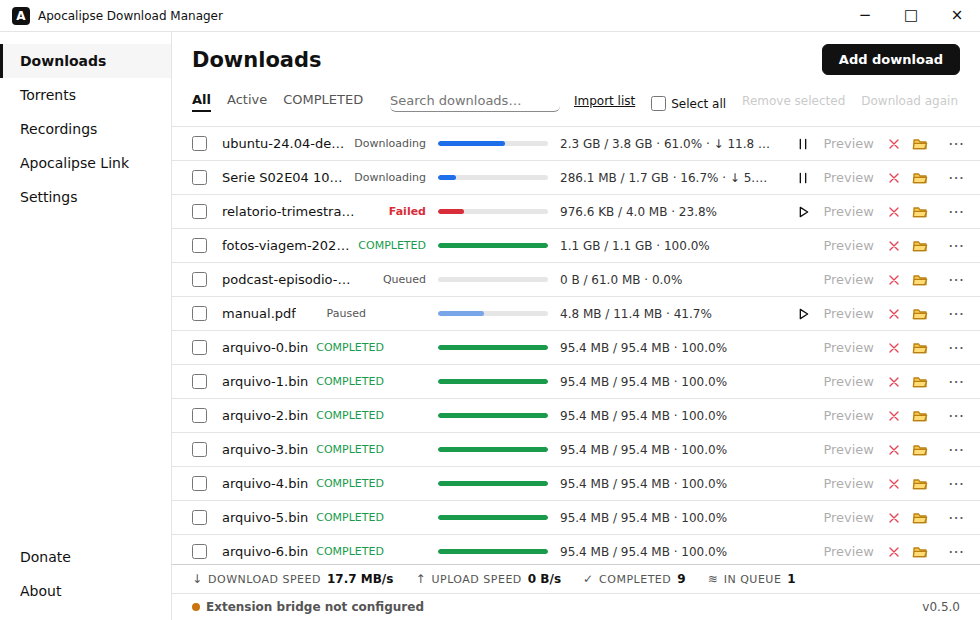

# Apocalipse Download Manager

[Português](README.md) · [English](README.en.md) · [简体中文](README.zh-CN.md)

适用于 Windows、Linux 和 macOS x64 的自由开源便携下载管理器。

[**下载**](https://github.com/linuxhell/apocalipse-download-manager/releases/latest)

| 平台 | 软件包 |
| --- | --- |
| Windows x64 | [Portable ZIP](https://github.com/linuxhell/apocalipse-download-manager/releases/latest/download/apocalipse-download-manager-windows-x64-portable.zip) |
| Linux x64 | [Portable tar.gz](https://github.com/linuxhell/apocalipse-download-manager/releases/latest/download/apocalipse-download-manager-linux-x64-portable.tar.gz) · [AppImage](https://github.com/linuxhell/apocalipse-download-manager/releases/latest/download/apocalipse-download-manager-linux-x64.AppImage) |
| macOS x64 | [Portable ZIP](https://github.com/linuxhell/apocalipse-download-manager/releases/latest/download/apocalipse-download-manager-macos-x64-portable.zip) |
| Chrome | [0.3.206 ZIP](https://github.com/linuxhell/apocalipse-download-manager/releases/latest/download/apocalipse-chrome-0.3.206.zip) |
| Edge | [0.3.206 ZIP](https://github.com/linuxhell/apocalipse-download-manager/releases/latest/download/apocalipse-edge-0.3.206.zip) |
| Firefox | [0.3.206 XPI](https://github.com/linuxhell/apocalipse-download-manager/releases/latest/download/apocalipse-firefox-0.3.206.xpi) |

新增下载窗口直接显示线程滑块，其值优先于引擎默认设置。下方复选框立即保存网站偏好；更改滑块会更新保存值，取消勾选会删除该偏好，同时保留网站凭据和其他设置。

## 快速开始

1. 下载并解压便携包，然后启动程序。便携包包含 Nibiru Xtreme，其源代码版本与 ADM 使用的固定版本一致。
2. 安装对应的浏览器扩展。Chrome/Edge：解压 ZIP，在开发者模式中选择**加载已解压的扩展程序**。Firefox：打开 Mozilla 签名的 XPI。
3. 打开**工具**，安装或更新 yt-dlp、FFmpeg 等所需引擎。AppImage 不包含 Xtreme 可执行文件，请在此安装。在 Linux 上，先为 AppImage 添加执行权限。

## 功能

- 支持断点续传的 HTTP/HTTPS、多连接、镜像与 SHA-256 校验。
- 原生种子、磁力链接及 ED2K/Kad，支持文件选择和视频预览。
- 浏览器媒体捕获、yt-dlp、HLS、FFmpeg 和渐进式录制。
- Apocalipse Link：计算机之间经过身份验证的 TLS 文件传输。
- 网站凭据保存在系统安全凭据库中；界面支持葡萄牙语、英语和简体中文。

## 0.7.2 版本

打开**添加下载**时，窗口会自动增高，为表单、线程设置和高级选项提供更多空间。关闭对话框后恢复原来的窗口大小和位置；小屏幕上仍可滚动。

ED2K 的**预览**按钮在首个分块通过 MD4 校验后启用：最多 **9,728,000 字节**，约 9.28 MiB。无需累计下载 30–40 MB。节点优先协助完成文件开头和末尾，再下载中间部分；MP4/AVI 可能还需要末尾的索引。尚未下载的范围会等待数据。

自动重试在重新检查期间保留当前进程已验证的预览映射。检查结果仍可撤销无效分块；重启程序或手动恢复需要重新验证。如果所有来源都缺少剩余分块，下载会保持未完成状态，保存已有数据并重试。

此版本还修复了 HTTP 锁清理、删除普通下载时的续传标识清理、Xtreme 监听器关闭和加密缓存并发写入。ADM **0.7.2**、Xtreme **0.2.1**、扩展 **0.3.206**。

## 构建与贡献

使用 `rust-toolchain.toml` 固定的 Rust 版本，并安装 [CI](.github/workflows/ci.yml) 中列出的系统依赖。运行 `cargo test --workspace --locked` 和 `node --test tests/*.test.cjs`。CI 测试三个系统和传输实验室；可手动启用 Debian、Fedora 和 Arch 的额外检查。发布流程复用通过 CI 验证的构建产物。

另请参阅[更新日志](CHANGELOG.md)、[技术审查](docs/AUDIT-2026-10-22.md)、[性能说明](docs/PERFORMANCE.md)和[安全策略](SECURITY.md)。此版本发布后，将根据日常使用中发现的问题进行维护。

[PayPal](https://www.paypal.com/cgi-bin/webscr?cmd=_donations&business=jv12802%40gmail.com&currency_code=BRL) · GPL-3.0-or-later.
